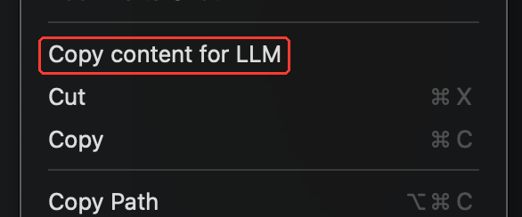

# rendergit

This is a personal fork of [Andrej Karpathy's rendergit](https://github.com/karpathy/rendergit), with additions for working with local projects and copying selected files into LLM chats.

## Why this fork?

Before AI coding agents became part of my workflow, I used rendergit every day to prepare code for LLM chat interfaces. I wanted to make it easier to choose the context to paste into a conversation, especially when working on local projects. These additions grew out of that workflow.

## What's added

- **Local directory support:** run `rendergit .` or pass a local project path to render the files on disk, including uncommitted changes, without cloning from GitHub.
- **CLI exclusions:** use the repeatable `--exclude` option to skip directory names, relative paths, or glob patterns. Common dependency and build directories such as `node_modules`, `.venv`, and `dist` are skipped by default, and excluded directories are pruned during scanning.
- **[VS Code extension](rendergit-vscode-extension/):** select files or folders in the Explorer, right-click, and choose **Copy content for LLM** to copy their contents as CXML directly to the clipboard. It also supports an optional tree of the selection and converts Jupyter notebooks into readable cell-based text, leaving out notebook outputs.



The original HTML viewer and Human/LLM views are described below.

## Overview

> Just show me the code.

Tired of clicking around complex file hierarchies of GitHub repos? Do you just want to see all of the code on a single page? Enter `rendergit`. Flatten any GitHub repository into a single, static HTML page with syntax highlighting, markdown rendering, and a clean sidebar navigation. Perfect for code review, exploration, and an instant Ctrl+F experience.

## Basic usage

Install and use easily with [uv](https://docs.astral.sh/uv/):

```bash
uv tool install git+https://github.com/matejaaj/rendergit
rendergit https://github.com/karpathy/nanogpt
rendergit . --exclude 'src/generated/**' --exclude 'coverage'
```

Alternatively, more manual pip install example:

```bash
git clone https://github.com/matejaaj/rendergit
cd rendergit
pip install -e .
rendergit https://github.com/karpathy/nanoGPT
```

The code will:
1. Use the local directory, or clone the remote repo to a temporary directory
2. Render its source code into a single static temporary HTML file
3. Automatically open the file in your browser

Once open, you can toggle between two views:
- **👤 Human View**: Browse with syntax highlighting, sidebar navigation, visual goodies
- **🤖 LLM View**: Copy the entire codebase as CXML text to paste into Claude, ChatGPT, etc.

There's a few other smaller options, see the code.

## Features

- **Dual view modes** - toggle between Human and LLM views
  - **👤 Human View**: Pretty interface with syntax highlighting and navigation
  - **🤖 LLM View**: Raw CXML text format - perfect for copying to Claude/ChatGPT for code analysis
- **Syntax highlighting** for code files via Pygments
- **Markdown rendering** for README files and docs
- **Smart filtering** - skips binaries and oversized files
- **Directory tree** overview at the top
- **Sidebar navigation** with file links and sizes
- **Responsive design** that works on mobile
- **Search-friendly** - use Ctrl+F to find anything across all files

## Contributing

For issues or suggestions about the additions in this fork, use [this repository's issue tracker](https://github.com/matejaaj/rendergit/issues). For the original project and its contribution policy, see [upstream rendergit](https://github.com/karpathy/rendergit#contributing).

## License

BSD0 go nuts
